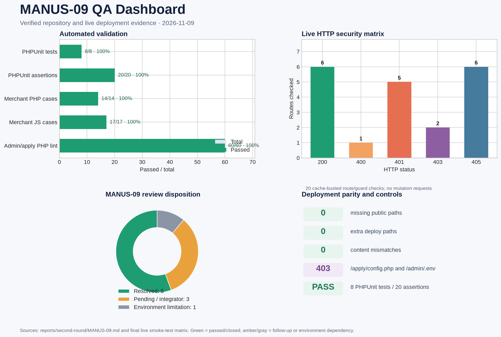

# MANUS-09 QA Review and Visualization

**Review date:** 2026-11-09  
**Evidence source:** `reports/second-round/MANUS-09.md`, final local test runs, and the cache-busted live smoke matrix.

## QA result at a glance

The recorded automated checks are fully passing: PHPUnit is **8/8 tests and 20/20 assertions**, the merchant-response suites are **14/14 PHP cases** and **17/17 JavaScript cases**, and the admin/apply surface is **60/60 PHP files lint-clean**. The live matrix contains 20 non-mutating route and guard checks: six HTTP 200 responses, one validation rejection (400), five authentication rejections (401), two protected-file denials (403), and six method rejections (405). These statuses are expected for the routes and invalid requests tested.

Deployment parity is also complete: `origin/main` is `37b3a793e00662dd7ecc5e4cddc0d823a378d372`, `origin/adopt-deploy` is `e8c88ae7c04fc11383c715d0f0770b15254bde2c`, and the normalized comparison reports zero missing paths, zero extra paths, and zero content mismatches.

## Resolved bug items

| Item | Verification |
|---|---|
| Chat rating accepted an email unrelated to the chat owner | Fixed with stored-thread email ownership validation and parameterized lookup in `adopt/admin/chat-rate.php`; the PHPUnit suite covers the mismatch rejection. |
| Chat rating JSON writes could lose concurrent reviews | Fixed with exclusive-lock append behavior; the successful persistence test passes. |
| Adoption-code traversal and unlocked writes | Fixed in `adopt/admin/update-adoption.php`; codes are normalized and constrained to `AD-#####-####`, with `LOCK_EX` writes. |
| Lowercase adoption-code regression | Fixed after clean-main integration exposed it; valid lowercase codes are normalized before file lookup. |
| Malformed testimonial chat-widget URLs | Fixed across all four affected testimonial variants; the root-relative `/admin/chat-widget.js` reference is present. |
| Apply-layer `config.php` dependency | Removed from active and legacy adoption handlers; they now use `adopt/apply/apply-env.php` and protected `admin/.env` values. |
| Public exposure of legacy configuration paths | Deployment-root and apply-level Apache rules added; live `/apply/config.php` and `/admin/.env` checks return HTTP 403. |
| Main/deploy drift | Resolved through the documented flatten-and-publish workflow; normalized tree parity is exact. |

## Remaining items and deployment checks

These are not unresolved MANUS-09 code defects in the deployed changes, but documented cross-project dependencies that remain outside this package or require authenticated production-only verification:

| Item | Current status | Next owner/check |
|---|---|---|
| Pet-match server endpoints | Still absent from the repository/deploy tree. | Web Project 5b/Task 6a integrator must implement the backend contract. |
| Rehoming private JSON under web root | Security concern remains documented; protected payloads were not opened. | C5/E2/integrator must deny public access or move private storage outside web root. |
| Authenticated admin upload flows | Guard/method checks passed, but no real admin credential or file upload was used. | Deployment owner should run a controlled authenticated upload/cleanup test. |
| Authenticated public/contact/chat upload flows | Missing-file and method guards passed; full valid-upload flow remains unverified. | Run controlled staging/production integration tests with disposable files. |
| Live database-backed authenticated flows | Not executed from the sandbox because PHP CLI lacks `pdo_mysql` and no production session was used. | Run read-only authenticated checks in the server runtime with its configured driver. |
| `chat-config.php` credential migration | Intentionally not changed; it is a shared foundation requiring coordinated `.env` provisioning. | Treat as a separate sitewide migration, not a silent MANUS-09 patch. |

## Interpretation

The MANUS-09 fixes that were within the scoped repository and deployment workflow are implemented, tested, merged into `main`, and published through `adopt-deploy`. The remaining rows are explicit cross-project or authenticated-environment dependencies; they should not be represented as passed merely because unauthenticated route guards returned expected responses.
